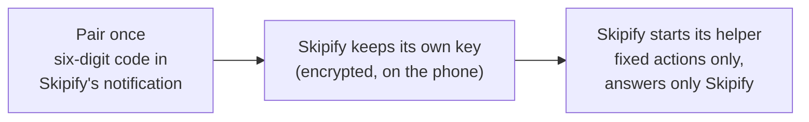
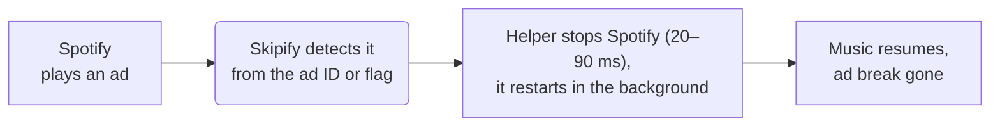
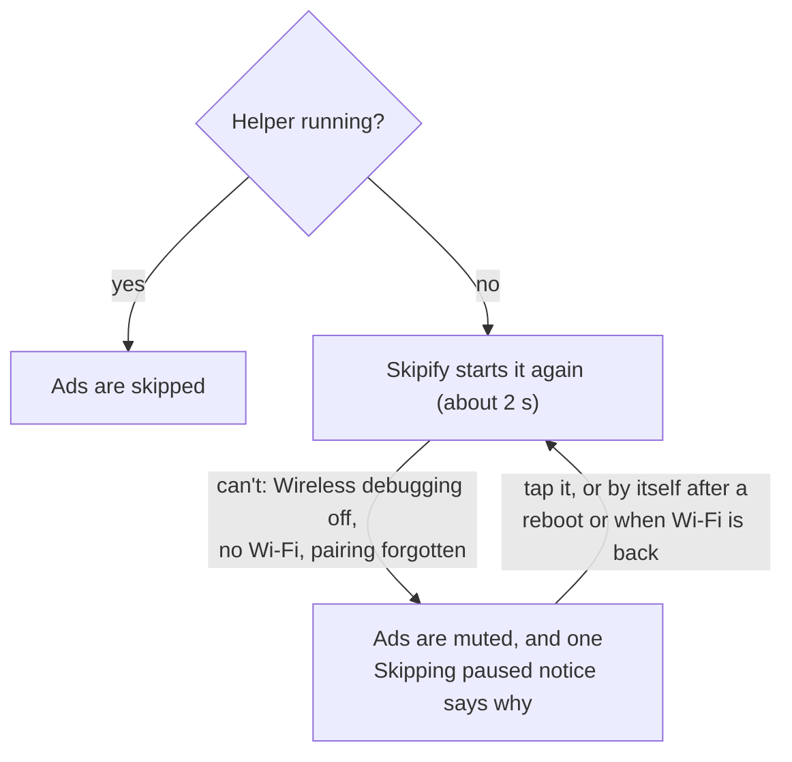

# Skipify

**Ad-free listening for Spotify on Android — no root needed, no modified Spotify app.**

[How it works](docs/HOW-IT-WORKS.md) ·
[Security](SECURITY.md) ·
[Changelog](CHANGELOG.md)

---

Skipify runs alongside the official Spotify app. The moment Spotify starts an ad break, Skipify restarts
Spotify in the background — which discards the entire break — and your music continues a few
seconds later. An optional on-device DNS filter, applied to Spotify only, can also remove video
ads and the playback freezes they cause.

Skipify is the only app you need for skipping and setup: it pairs with Android's Wireless debugging
by itself and starts its own small helper. Shizuku still works if you already use it, and rooted
phones can use root instead of pairing.

## Features

| | |
| --- | --- |
| **Skips whole ad breaks** | Every ad is recognised from Spotify's own metadata — including the first ad of a multi-ad break — and music is back about 2 to 3 seconds later. |
| **Leaves your phone alone** | No screen wake-ups. A locked phone stays locked, the app you are using stays in front, and Spotify never pops up on screen when it was in the background. Its lock-screen controls come back right away. Music keeps playing with the screen off. |
| **Keeps your place** | If Spotify comes back on a different playlist or album after a restart, Skipify switches back to the one you were playing. |
| **Sleep timer that survives skips** | Spotify's own timer is lost whenever Spotify restarts, so Skipify has its own: 5 minutes to 1 hour, any custom time (hours, minutes, seconds), or end of song. |
| **Mute mode** | Prefer not to restart Spotify? Skipify can mute ads instead, and does so automatically (with one notification) whenever skipping is not ready. |
| **Spotify-only DNS filter (optional)** | Off by default. Turn on **Block ad servers** to block video-ad hosts and the ad-asset host that can freeze background playback. Other apps and all non-DNS traffic are untouched. |
| **One app, guided setup** | Skipify pairs with Wireless debugging itself: you type a six-digit code into its notification, once. No computer, no second app. |
| **Looks after itself** | If its helper stops, Skipify starts it again; if Spotify crashes right after a skip, Skipify starts Spotify again. After a reboot one tap brings skipping back, or Skipify does it by itself if you turn on automatic restart. |
| **Private** | No accounts, analytics or tracking. Nothing about you leaves the device; with the DNS filter on, only Spotify's own DNS lookups are forwarded. |

## Requirements

- Android 11 or newer to skip ads. Wi-Fi is needed only to pair and to start Skipify's helper (once
  after each reboot), because Android turns on Wireless debugging only on Wi-Fi. After that, skipping
  works on mobile data too (Skipify turns on USB debugging for this, see Troubleshooting).
  On Android 8 to 10 Skipify can skip through [Shizuku](https://shizuku.rikka.app/) started from a
  computer, or mutes ads.
- The official [Spotify](https://play.google.com/store/apps/details?id=com.spotify.music) app (free tier)

## Installation

### Steps

1. Build a debug or signed release APK locally by following [CONTRIBUTING.md](CONTRIBUTING.md), or
   use the included GitHub Actions build artifact when this project is hosted on GitHub. The workflow
   builds and tests; it does not publish releases. Skipify never checks a release feed or installs an
   APK by itself. Install the APK from `android/app/build/outputs/apk/` and allow installation from
   your file manager if Android asks.
2. Open Skipify and tap the **power button**. Skipify asks for what it needs, one step at a time:

   | Permission | Why |
   | --- | --- |
   | Notification access | Read Spotify's "now playing" information to recognise ads. Android calls this "notification read, reply & control"; Skipify doesn't read your notifications |
   | VPN (only if you turn on **Block ad servers**) | The local DNS filter (Spotify's DNS lookups only) |
   | Wireless debugging (pair once), or root | Start Skipify's helper, which restarts Spotify when an ad starts |
   | Notifications | Status, a **Turn off** button, and problem alerts |
   | Unrestricted battery | Keep working while the phone is locked |

3. Skipify opens **Set up skipping**. It takes about two minutes, once:
   1. **Turn on Developer options:** tap **Open**, then tap **Build number** seven times (in
      About phone). Come back to Skipify.
   2. **Pair Skipify:** tap **Pair**. Skipify opens Developer options. Turn on **Wireless debugging**
      (allow it on your Wi-Fi), open it and tap **Pair device with pairing code**.
   3. Stay on that screen: Skipify's **Enter the pairing code** notification pops up over it (if you
      miss it, pull down the notification shade and expand it). Tap **Enter code** and type the six
      digits shown in Settings. Skipify pairs and starts its helper; the notification changes to
      **Skipping is ready**.

   Some phone makers need one extra switch in Developer options; Skipify shows that step only on
   those phones. Already using Shizuku? Skipify uses it too, and you can skip this. On a rooted phone
   (Magisk, KernelSU, APatch) the setup screen offers **Use root** instead: one tap, no pairing and
   no Wi-Fi needed. Root is used only to start Skipify's helper.
4. Back in Skipify, allow **Notification access** and **Unrestricted battery** when asked.
5. Optional: turn on **Restart automatically after a reboot**. Skipify tests once (about 10 seconds)
   whether your phone keeps its helper running with Wireless debugging off, keeps it off if so,
   and shows the result.
6. Play something on Spotify and tap **Test ad skip** to hear the music come back.

> [!NOTE]
> Android turns Wireless debugging off when the phone restarts. With automatic restart on, Skipify
> reconnects by itself after you unlock the phone (Android 13+). If the phone starts without Wi-Fi,
> Skipify shows a notice and retries as soon as Wi-Fi returns. Without automatic restart,
> Skipify shows one **Skipping paused** notification: tap it and Skipify turns Wireless debugging back
> on and resumes. (On Android 11 and 12 Skipify may not switch it itself: the tap shows where to turn
> it on, and skipping resumes as soon as it is on.) Until then, ads are muted, not played.

## Usage

- **Power button** — turns Skipify on or off. The notification also has a **Turn off** button.
- **When an ad plays** — *Skip* (restart Spotify), *Mute*, or *Do nothing*.
- **Sleep timer** — use this instead of Spotify's timer; it survives ad skips.
- **In the car (Android Auto)** — *Skip*, *Mute* or *Do nothing* while Android Auto is connected.
  Skipping in the car never switches apps on the phone and waits until Android Auto is not reading
  from Spotify, so navigation keeps running. *Mute* mutes Spotify itself, since the car does not
  use the phone's volume (needs skipping set up).
- **DNS rules** — view or edit the filter (`block`, `nxdomain`, `redirect`, `ip`, `upstream`).
- **Restart automatically after a reboot** — Skipify brings skipping back by itself after a restart
  (Android 13+). Turn it off and on again to repeat the phone test.
- **Test ad skip** — restarts Spotify now, to check that your music comes back.
- **Recent activity** — every ad break, skip and change, with timings. If Skipify's helper can't
  start, the reason is shown here too.

## Troubleshooting

<b>Do Developer options and Wireless debugging have to stay on?</b>

Developer options: yes. Turning them off also stops Skipify's helper, and ads are muted instead of
skipped. Wireless debugging: by default Skipify leaves it the way you set it during setup. With
**Restart automatically after a reboot** on, Skipify tests once whether your phone keeps skipping
ready with Wireless debugging off; if it does, Skipify keeps it off and turns it on only for a few
seconds after a reboot. With **Skip** selected, Skipify also turns on USB debugging, which keeps its
helper running when Wireless debugging goes off.

<b>Does it work on mobile data?</b>

Yes. Wi-Fi is needed only to pair and to start Skipify's helper once after a reboot (Android turns on
Wireless debugging only on Wi-Fi; no internet is needed on that Wi-Fi). When Wi-Fi drops, Android
switches Wireless debugging off; with USB debugging also off it then stops its debugging service
and Skipify's helper with it. So with **Skip** selected, Skipify turns USB debugging on (shown in
**Recent activity**). If the helper does stop, ads are muted until Wi-Fi is back, and Skipify resumes
by itself.

<b>The APK doesn't install</b>

Skipify isn't on the Play Store, so Play Protect may warn about it: tap **More details** →
**Install anyway**. On some Android 16 phones the installer closes without a message because of
Google's developer verification for apps from outside the Play Store; turning Play Protect off for
the install (and back on afterwards) may get around it.

<b>Notification access is greyed out ("Restricted setting")</b>

Android 13 and newer do this for apps installed from a browser or a file manager. Open
**Settings → Apps → Skipify**, tap **⋮** at the top right, then **Allow restricted settings**, and
turn on notification access again. Skipify shows these steps with an **App info** button if access
is still off after you tapped Allow.

<b>Ads are muted instead of skipped</b>

Skipping is not ready: usually Wireless debugging is off after a reboot, or Skipify had to start its
helper while the phone was not on Wi-Fi (it resumes as soon as Wi-Fi is back). Tap Skipify's
notification, or open Skipify — the status card says what is missing. If Skipify asks to pair again,
Android has forgotten the pairing (it does that for pairings unused for 7 days unless **Disable adb
authorization timeout** is on in Developer options).

<b>Copy diagnostics</b>

Settings → **Copy diagnostics** copies a short report (phone maker and model, Android version,
Spotify version, how Skipify skips, Wi-Fi and Android Auto state, the last problems Skipify logged) for a
bug report. It has nothing about what you listen to, and Skipify never sends it anywhere by itself.

<b>Music does not come back after a skip</b>

Use **Test ad skip** to reproduce it. Skipify retries once and then shows a notification; tapping it
opens Spotify. Make sure Skipify and Spotify have unrestricted battery use. If Spotify plays after a
skip but its notification is missing, or it stops a few minutes later, Spotify is probably
restricted in the background (its battery setting): Skipify lifts that by itself and says so in Recent
activity. Only if it can't (no helper or Shizuku) it shows **Spotify in the background** with a
**Fix** button. On Xiaomi, Redmi and POCO phones, also allow **Autostart** for Spotify and set its
battery saver to **No restrictions** (Settings → Apps → Spotify). If it still fails, Recent
activity shows the steps of the failed try: please include them in an issue.

<b>Removing Skipify or its pairing</b>

Uninstalling Skipify also stops its helper. The pairing stays listed under Developer options →
Wireless debugging → **Paired devices** as "Skipify"; tap it and **Forget** to remove it too.

<b>"Another VPN app took over"</b>

Android allows one VPN at a time. Skipify's ad skipping keeps working without its DNS filter; turn
**Block ad servers** off, or stop the other VPN.

## How it works

**Once: setup.** Skipify pairs with Android's Wireless debugging like a computer would, and starts
its own small helper with the same rights as `adb shell`. The helper answers only Skipify and can
do only a fixed list of actions. On a rooted phone Skipify starts the same helper with root instead
(as the shell user, so with the same rights), and no pairing is needed.

**Every ad break.** Spotify keeps an ad break only in memory, so a cold restart resumes the queue
at the next song. Spotify is started again the way a headset play button starts it: no screen
appears, and a locked phone stays locked.

**Looks after itself.** Skipping never stops without you being told.

Spotify is watched the same way after every skip: if it comes back without its playback service
(no notification), Skipify repairs that, and if it crashes in its first seconds, Skipify starts it again.
If you closed Spotify yourself, it stays closed.

The tricky parts (Spotify's media-button intent being cancelled by a force-stop, keeping the
screen state untouched, Android's background-audio rules, the pairing protocol and reboot handling)
are documented in [docs/HOW-IT-WORKS.md](docs/HOW-IT-WORKS.md).

## Known issues

- Restoring the previous playlist works for playlists and albums, not for an artist's
  "Popular" list or radio (Skipify leaves those as Spotify brings them back).
- Android Auto: tested with real ads in Android Auto's desktop head unit (the car screen
  emulator), not yet in a car. If a skip still restarts Android Auto, choose **Mute** under **In the
  car** and open an issue.

## Privacy & security

Skipify holds two powerful capabilities — adb-level rights through its own helper (or Shizuku) and a
VPN — and is built so neither can be misused: the helper answers only Skipify and runs only a fixed
list of actions, every value passed to it is validated and quoted, the DNS
forwarder accepts replies only from its resolver, all data stays in private storage and is
excluded from backups, and release builds do not log what you play. Details, and how to report a
vulnerability privately, are in [SECURITY.md](SECURITY.md).

## Contributing

Found a bug or have an idea? Open an issue from this repository's **Issues** tab:
bugs and feature requests are handled in public. Pull requests are welcome too:
[CONTRIBUTING.md](CONTRIBUTING.md) explains how to build and test Skipify. Security vulnerabilities
are the one exception: please report those privately as described in [SECURITY.md](SECURITY.md).

## Disclaimer

Skipify is an independent project. It is not affiliated with, endorsed by or connected to Spotify AB;
Spotify is a trademark of Spotify AB. Blocking ads may be against Spotify's terms of service — use
Skipify at your own risk. If you enjoy Spotify, consider supporting artists with Spotify Premium.

## Listener-connection reliability

Beyond Hush's original approach, Skipify adds reliability-focused measures for its notification-listener connection. With Skipify enabled and notification access granted, these include:

- Durable retries backed by persisted state and scheduled alarms, re-armed at app startup, after a reboot and after app updates.
- Connection checks and rebind requests when the app starts or returns to the foreground, with duplicate-request throttling.
- A manual **Fix** action that opens Android's notification-access settings.

These additions reflect our effort to make the listener connection as reliable as possible.

## Original source

Skipify is a substantially modified fork of [Hush](https://github.com/coldMEW/Hush) by coldMEW, not a ground-up rewrite. It retains much of Hush's code and core functionality. It has been rebranded as Skipify, with a refreshed interface, colors and icon, and Hush's update-check and self-installer have been removed; Skipify does not check for or install updates itself. Skipify remains licensed under the [GNU General Public License v3.0](LICENSE). Hush is acknowledged here as the upstream source; this is not a source for Skipify downloads or releases.

## License

Skipify is free software, released under the [GNU General Public License v3.0](LICENSE).
